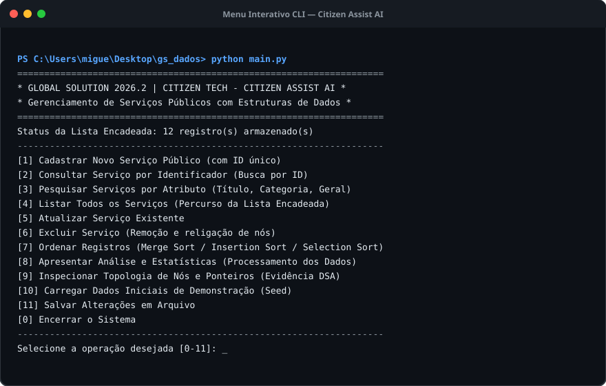
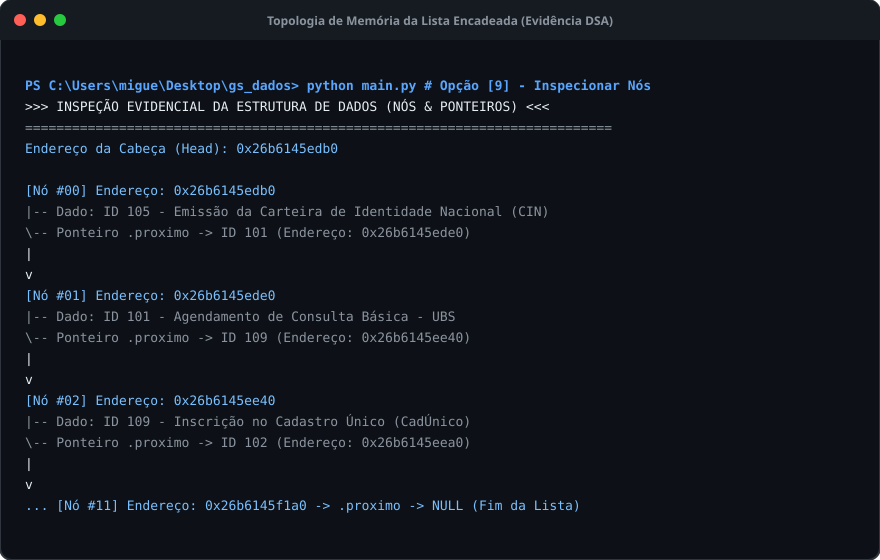
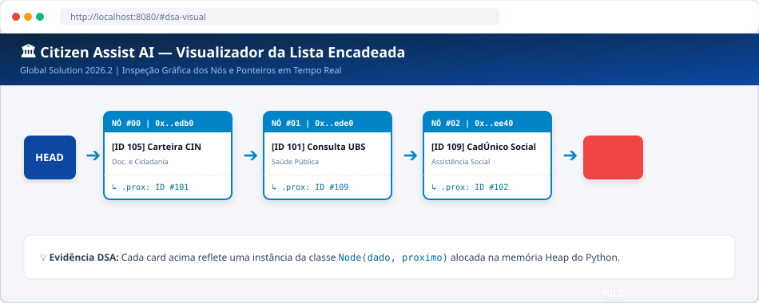
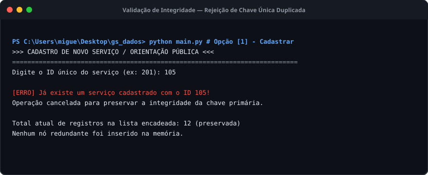
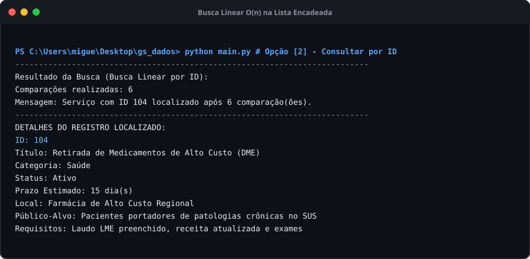
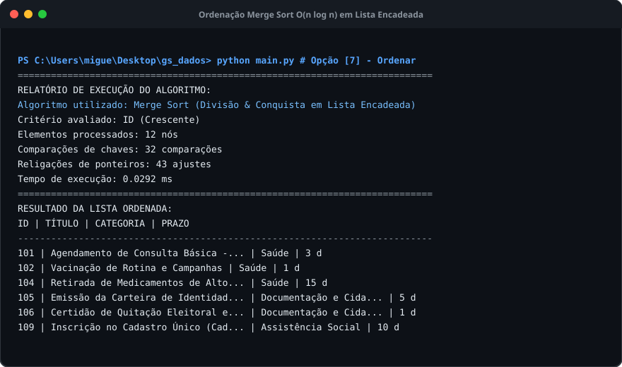
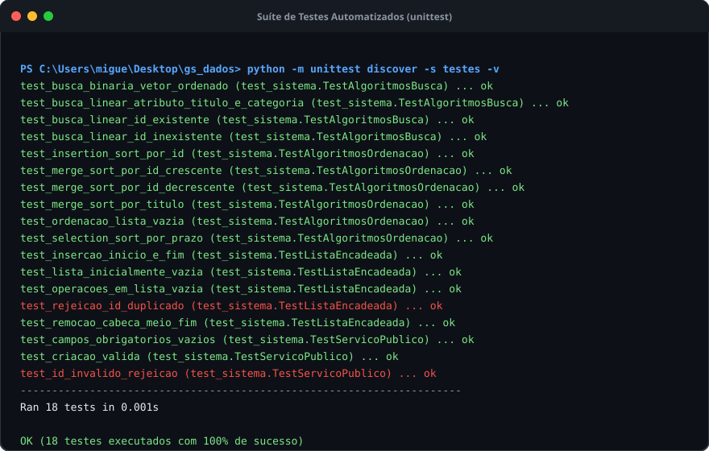

# GUIA DE DEMONSTRAÇÃO PRÁTICA DO SISTEMA (COM EVIDÊNCIAS VISUAIS)

**Global Solution 2026.2 — Citizen Tech**  
**Citizen Assist AI | Data Structures and Algorithms (DSA)**  

### 👥 Integrantes da Equipe
- **Miguel Putini** — RM 571624
- **Alexandre Rizzi** — RM 569621
- **Lucas Klein de Veiga** — RM 570029

---
> *"A demonstração deverá evidenciar o funcionamento real das estruturas e algoritmos, não apenas a apresentação de telas."*

---

## 1. Modos de Execução da Demonstração

| Modo | Comando de Execução | Atalho Rápido (Windows) | Finalidade Principal |
|---|---|---|---|
| **Demonstração Guiada DSA** | `python demo.py` | [`run_demo.bat`](file:///c:/Users/migue/Desktop/gs_dados/run_demo.bat) | Percorre automaticamente as 8 etapas com logs e endereços de memória. |
| **Menu Interativo (CLI)** | `python main.py` | [`run.bat`](file:///c:/Users/migue/Desktop/gs_dados/run.bat) | Permite ao avaliador testar inputs, buscas e ordenações manualmente. |
| **Portal Web & Visualizador** | `python web_app.py` | [`run_web.bat`](file:///c:/Users/migue/Desktop/gs_dados/run_web.bat) | Apresentação em interface web moderna em `http://localhost:8080`. |
| **Suíte de Testes (unittest)** | `python -m unittest discover -s testes -v` | [`run_tests.bat`](file:///c:/Users/migue/Desktop/gs_dados/run_tests.bat) | Comprovação técnica de 100% de aprovação nos 18 testes formais. |

---

## 2. Evidências Visuais e Roteiro Passo a Passo

### Etapa 1: Menu Interativo e Inicialização
Ao iniciar o sistema via [`main.py`](file:///c:/Users/migue/Desktop/gs_dados/main.py), a base inicial é carregada na lista encadeada e o menu interativo com 11 operações é disponibilizado.

---

### Etapa 2: Comprovação da Lista Encadeada em Memória (Evidência DSA)
Na **Opção [9]** do menu ou na aba gráfica do site, o sistema expõe explicitamente como os dados estão organizados: cada elemento está em um `Node` com seu endereço hexadecimal de memória física, conectando ao próximo nó através do ponteiro `.proximo` até atingir `NULL`.

Também visível de forma visual no Portal Web:

---

### Etapa 3: Tratamento de Integridade e Bloqueio de ID Duplicado
Na **Opção [1]** do menu, ao tentar cadastrar um serviço com um ID já existente na lista (ex: ID `105`), o método `existe_id()` bloqueia a inserção imediatamente, impedindo a alocação de nós redundantes e preservando a chave primária.

---

### Etapa 4: Algoritmo de Busca Linear com Métricas Assintóticas
Na **Opção [2]**, a busca por ID executa a busca sequencial na lista encadeada e exibe a quantidade exata de comparações realizadas:
- **Caso Existente:** Localiza o registro e exibe todos os requisitos e orientações ao cidadão.
- **Caso Inexistente (ex: ID 9999):** Percorre os $n$ nós da lista ($O(n)$) e informa que o registro não foi localizado, sem falhas de execução.

---

### Etapa 5: Bancada de Ordenação (Merge Sort $O(n \log n)$ vs. Insertion Sort $O(n^2)$)
Na **Opção [7]**, o sistema permite ordenar os nós da lista encadeada por ID, Título ou Categoria sem utilizar qualquer função pronta da linguagem (`.sort()` ou `sorted()`). O sistema compara as comparações e religações de ponteiros efetuadas.

---

### Etapa 6: Comprovação dos 18 Testes Automatizados
Execução formal da suíte de testes unitários ([`testes/test_sistema.py`](file:///c:/Users/migue/Desktop/gs_dados/testes/test_sistema.py)), atestando 100% de sucesso em casos normais, inexistentes, entradas inválidas e operações com lista vazia.

---

## 3. Lista de Fotos para Tirar na Sua Máquina (Caso Queira Capturar com Suas Próprias Telas)

Caso seu professor exija capturas feitas diretamente pelo seu próprio computador (exibindo a barra de tarefas do seu Windows ou seu nome de usuário no terminal), siga este checklist de apenas **5 capturas rápidas**:

1. **Foto 1 (Menu CLI):** Dê dois cliques em [`run.bat`](file:///c:/Users/migue/Desktop/gs_dados/run.bat) e aperte `Win + Shift + S` para capturar a janela do terminal com o menu.
2. **Foto 2 (Inspeção dos Nós DSA):** No menu, digite `9` e aperte Enter. Tire print dos nós exibindo os endereços de memória `0x...` e os ponteiros `.proximo`.
3. **Foto 3 (Bloqueio de ID Duplicado):** No menu, digite `1`, informe o ID `105` e tire print da mensagem de bloqueio.
4. **Foto 4 (Ordenação Merge Sort):** No menu, digite `7`, escolha ordenar por ID com Merge Sort e tire print das estatísticas de comparações.
5. **Foto 5 (Portal Web):** Dê dois cliques em [`run_web.bat`](file:///c:/Users/migue/Desktop/gs_dados/run_web.bat), abra `http://localhost:8080` no navegador e tire print da tela com o catálogo e o visualizador de nós.
