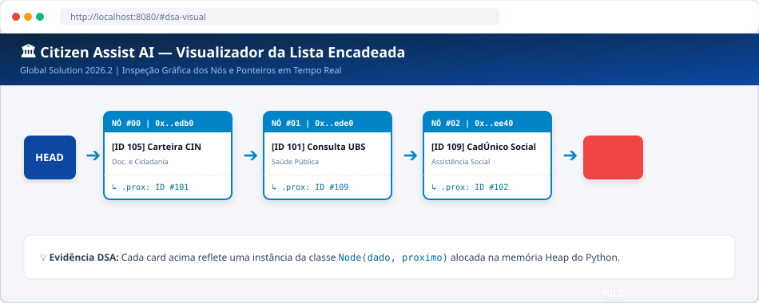
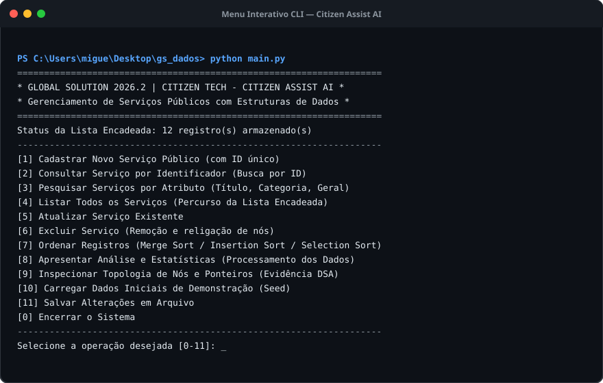
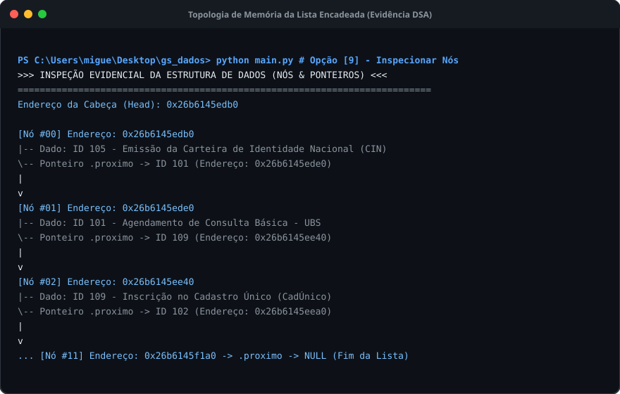
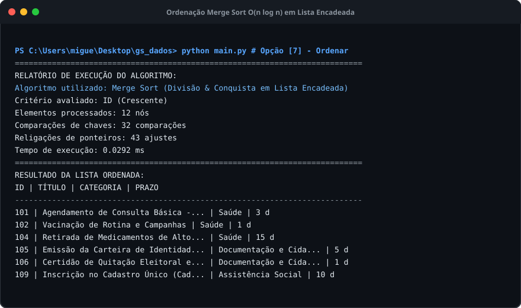

# CITIZEN ASSIST AI — PLATAFORMA DE SERVIÇOS PÚBLICOS E CIDADANIA

**Global Solution 2026.2 — Citizen Tech**  
**Disciplina:** Data Structures and Algorithms (DSA)  
**Linguagem:** Python 3.12+ (Biblioteca Padrão, Sem Dependências Externas)  
**Repositório Oficial:** https://github.com/MiguelPutini/GS2_dados.git  

---

## 👥 Integrantes do Grupo

- **Miguel Putini** — RM 571624
- **Alexandre Rizzi** — RM 569621
- **Lucas Klein de Veiga** — RM 570029

---

## 📌 Visão Geral do Projeto

O **Citizen Assist AI** é um sistema de gerenciamento, organização e consulta de informações públicas ao cidadão. O projeto foi projetado e implementado aplicando rigorosamente os fundamentos de **Estruturas de Dados e Algoritmos (DSA)**, mantendo os registros exclusivamente em uma **Lista Simplesmente Encadeada** desenvolvida do zero pela equipe, com algoritmos próprios de busca e ordenação (*Merge Sort*, *Insertion Sort* e *Selection Sort*).

---

## 📸 Demonstração Visual e Evidências das Estruturas de Dados

### 1. Visualizador Gráfico da Lista Encadeada (Nós & Ponteiros)
Exibição gráfica de cada instância da classe `Node` alocada na memória Heap, com dados do serviço público e ponteiro explícito `self.proximo` até o nó final `NULL`:



### 2. Menu Interativo via Linha de Comando (CLI)
Interface de terminal com validações ativas de entrada, busca e ordenação:



### 3. Inspeção Topológica em Memória (Evidência Real de DSA)
Comprovação dos endereços hexadecimais em memória física e religamento dos ponteiros:



### 4. Algoritmo de Ordenação Merge Sort na Lista Encadeada
Ordenação com técnica dos ponteiros lento e rápido (*Slow & Fast Pointer*), com métricas de comparações e trocas:



---

## 🎯 Atendimento Integral aos Requisitos do Edital

| Seção do Edital | Requisito Formal | Status | Onde Encontrar no Projeto |
|---|---|---|---|
| **3.1 / 3.4** | Cadastro com chave única em Lista Encadeada própria | **100% Atendido** | [`src/estruturas/lista_encadeada.py`](file:///c:/Users/migue/Desktop/gs_dados/src/estruturas/lista_encadeada.py), [`src/estruturas/no.py`](file:///c:/Users/migue/Desktop/gs_dados/src/estruturas/no.py) |
| **3.2** | Algoritmo próprio de busca (ID e Atributos) com tratamento sem resultado | **100% Atendido** | [`src/algoritmos/busca.py`](file:///c:/Users/migue/Desktop/gs_dados/src/algoritmos/busca.py) |
| **3.3** | Algoritmo próprio de ordenação (Merge Sort / Insertion Sort sem `.sort()`) | **100% Atendido** | [`src/algoritmos/ordenacao.py`](file:///c:/Users/migue/Desktop/gs_dados/src/algoritmos/ordenacao.py) |
| **3.5** | Atualização, exclusão e processamento analítico (estatísticas) | **100% Atendido** | Métodos `remover_por_id`, `atualizar` e `gerar_estatisticas` |
| **3.6** | Menu interativo com validação de entradas, ID duplicado e lista vazia | **100% Atendido** | [`src/cli/menu.py`](file:///c:/Users/migue/Desktop/gs_dados/src/cli/menu.py), [`main.py`](file:///c:/Users/migue/Desktop/gs_dados/main.py) |
| **4.0** | Complexidade Big-O e Testes (normais, inexistentes, inválidos, lista vazia) | **100% Atendido** | [`ANALISE_ALGORITMOS_BIG_O.md`](file:///c:/Users/migue/Desktop/gs_dados/ANALISE_ALGORITMOS_BIG_O.md), [`testes/test_sistema.py`](file:///c:/Users/migue/Desktop/gs_dados/testes/test_sistema.py) |
| **5.0** | Funcionalidades adicionais: Persistência JSON e Portal Web interativo | **100% Atendido** | [`src/persistencia/repositorio.py`](file:///c:/Users/migue/Desktop/gs_dados/src/persistencia/repositorio.py), [`web_app.py`](file:///c:/Users/migue/Desktop/gs_dados/web_app.py) |
| **6.0** | Todos os entregáveis documentados | **100% Atendido** | Documentações `.md`, suíte de testes e demonstração |

---

## 🚀 Instruções de Execução

O projeto **não exige instalação de bibliotecas via pip** (usa 100% a biblioteca nativa do Python 3).

### Opção 1: Execução no Terminal (Menu CLI Interativo)
No terminal ou PowerShell na pasta raiz:
```powershell
python main.py
```
*(Ou dê um duplo clique no arquivo [`run.bat`](file:///c:/Users/migue/Desktop/gs_dados/run.bat) no Windows).*

### Opção 2: Execução da Demonstração Guiada (Evidência Automatizada de DSA)
Executa passo a passo a comprovação dos nós, busca, tratamento de duplicatas e ordenação:
```powershell
python demo.py
```
*(Ou dê um duplo clique em [`run_demo.bat`](file:///c:/Users/migue/Desktop/gs_dados/run_demo.bat)).*

### Opção 3: Execução da Suíte de Testes Automatizados (18 Testes)
```powershell
python -m unittest discover -s testes -v
```
*(Ou dê um duplo clique em [`run_tests.bat`](file:///c:/Users/migue/Desktop/gs_dados/run_tests.bat)).*

### Opção 4: Execução do Portal Web Citizen Tech & Visualizador Gráfico de Nós
Inicia o servidor HTTP nativo e disponibiliza o portal no navegador:
```powershell
python web_app.py
```
*(Ou dê um duplo clique em [`run_web.bat`](file:///c:/Users/migue/Desktop/gs_dados/run_web.bat)).*  
Acesse no seu navegador: **`http://localhost:8080`**

---

## 📂 Estrutura de Arquivos do Projeto

```text
gs_dados/
│
├── main.py                     # Ponto de entrada do Menu CLI
├── web_app.py                  # Ponto de entrada do Portal Web
├── demo.py                     # Script de demonstração guiada
│
├── run.bat                     # Atalho Windows para Menu CLI
├── run_web.bat                 # Atalho Windows para Portal Web
├── run_tests.bat               # Atalho Windows para Suíte de Testes
├── run_demo.bat                # Atalho Windows para Demonstração
│
├── src/
│   ├── modelos/
│   │   └── servico.py          # Classe ServicoPublico e validações ativas
│   ├── estruturas/
│   │   ├── no.py               # Classe Node (referências explícitas)
│   │   └── lista_encadeada.py  # Singly Linked List (CRUD e estatísticas)
│   ├── algoritmos/
│   │   ├── busca.py            # Busca linear (ID/atributos) e binária
│   │   └── ordenacao.py        # Merge Sort e Insertion Sort manuais
│   ├── persistencia/
│   │   └── repositorio.py      # Carga e gravação em JSON
│   ├── cli/
│   │   └── menu.py             # Interface de terminal com validações
│   └── web/
│       ├── servidor.py         # Servidor HTTP RESTful nativo
│       └── estaticos/
│           ├── index.html      # Página do Portal do Cidadão
│           ├── estilo.css      # Estilização moderna e responsiva
│           └── app.js          # Lógica frontend e visualizador de nós
│
├── dados/
│   └── servicos_iniciais.json  # 12 serviços públicos cadastrados
│
├── docs/
│   └── imagens/                # Imagens e evidências visuais em alta resolução
│
├── testes/
│   └── test_sistema.py         # 18 casos de teste cobrindo todas as exigências
│
├── DOCUMENTACAO_TECNICA.md     # Entregável 1: Recorte, nós e menu
├── ANALISE_ALGORITMOS_BIG_O.md # Entregável 2: Análise formal de complexidade
├── EVIDENCIAS_TESTES.md        # Entregável 3: Matriz de testes e logs
├── DEMONSTRACAO_GUIA.md        # Entregável 4: Roteiro prático com imagens
└── README.md                   # Manual geral ilustrado
```
